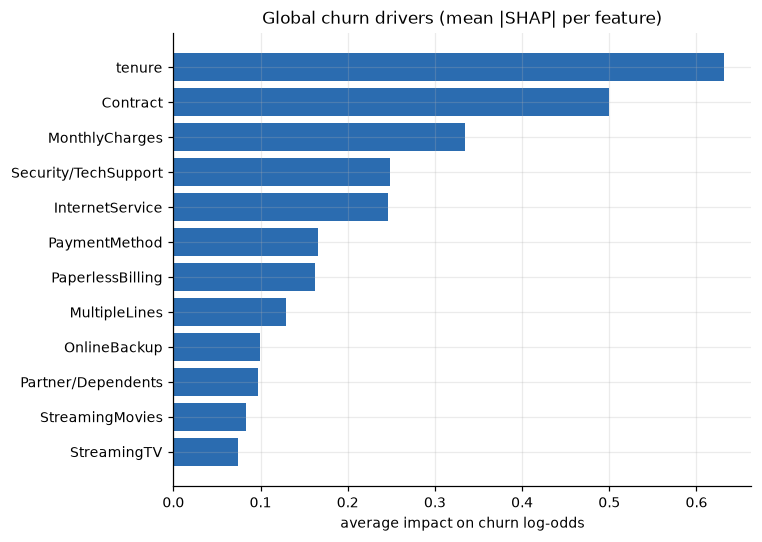
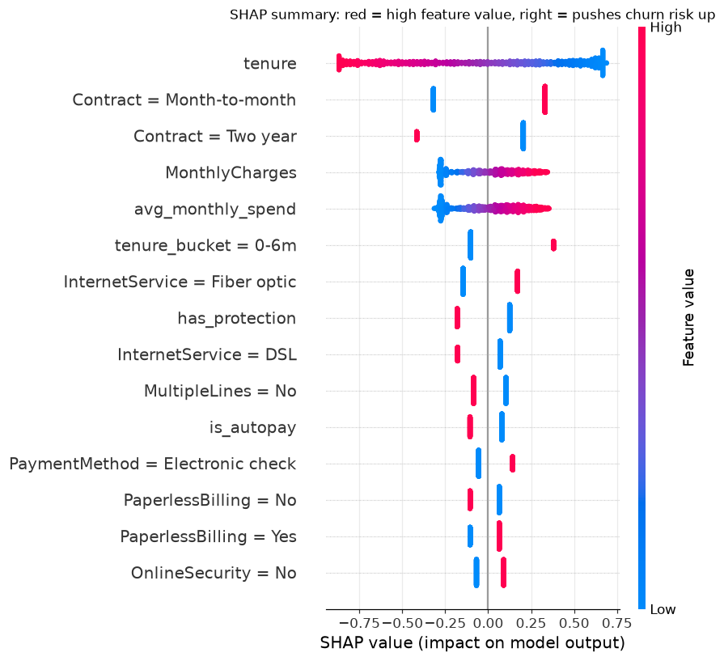

# SHAP Explainability Report (BR-03)

**Model explained:** logistic regression (SHAP `LinearExplainer`; tree models would use `TreeExplainer`). Values are in **log-odds of churn before calibration**: positive = pushes the customer towards churn, negative = pushes towards staying.

## Global drivers - what matters most overall (hold-out set)
Related columns are merged into one driver (e.g. tenure + tenure bucket + total charges = "tenure").

| driver | mean abs SHAP |
|---|---|
| tenure | 0.631 |
| Contract | 0.500 |
| MonthlyCharges | 0.335 |
| Security/TechSupport | 0.249 |
| InternetService | 0.246 |
| PaymentMethod | 0.166 |
| PaperlessBilling | 0.162 |
| MultipleLines | 0.129 |
| OnlineBackup | 0.099 |
| Partner/Dependents | 0.098 |

## Which customer situations raise or lower risk
Average SHAP value among customers who have this characteristic (only levels with at least 100 hold-out customers).

**Raise risk**

| level | customers | avg_shap |
|---|---|---|
| tenure_bucket = 0-6m | 311 | 0.381 |
| Contract = Month-to-month | 773 | 0.331 |
| InternetService = Fiber optic | 613 | 0.171 |
| PaymentMethod = Electronic check | 474 | 0.142 |
| MultipleLines = No phone service | 123 | 0.122 |
| PhoneService = No | 123 | 0.122 |

**Lower risk**

| level | customers | avg_shap |
|---|---|---|
| Contract = Two year | 336 | -0.416 |
| tenure_bucket = 13-24m | 206 | -0.180 |
| InternetService = DSL | 484 | -0.178 |
| tenure_bucket = 25-48m | 304 | -0.148 |
| PaymentMethod = Mailed check | 326 | -0.108 |
| PaperlessBilling = No | 569 | -0.105 |

## How to read the per-customer output
`reports/scored_customers.csv` (and the dashboard) give every customer three columns `driver_1..3` = the three drivers pushing **that customer's** risk up the most, with the SHAP effect size. 100% of customers have three drivers.

## Caveats
* SHAP explains **what the model uses**, not what *causes* churn. A driver like "Fiber optic" may stand for price, service quality or competition. Uplift/causal modelling is out of scope (BRD section 4).
* Many columns are correlated (tenure, total charges, contract); SHAP splits credit between them, which is why related columns are grouped.
